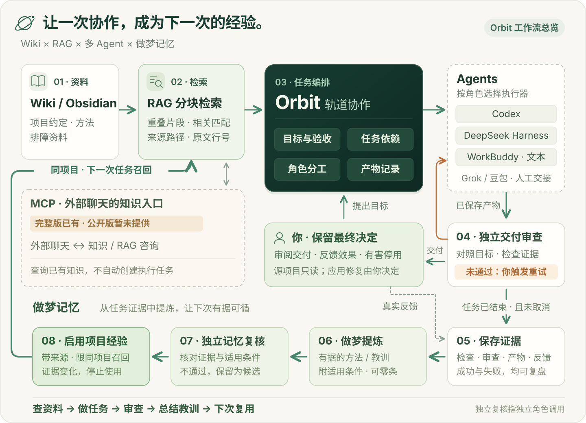

# 轨道协作 Orbit

**让 Agent 带着项目知识工作，把解决问题的过程沉淀成下一次可用的经验。**

**Wiki 知识库 · RAG 分块检索 · MCP 知识入口〔暂未公开〕 · 做梦记忆 · 多 Agent 协作**

Orbit 是一个独立的本地多 Agent 项目协作平台。它把已有资料、任务分工、结果审查和经验复用连接起来：开始任务时查找项目知识，处理过程中保留成果与依据，结束后整理值得保留的方法和教训，让同项目后续任务可以继续使用这些积累。

[下载 v0.1.0](https://github.com/zhouxinsen77-ux/orbit-collab/releases/tag/v0.1.0) · [安装与配置](#下载安装) · [源码](https://github.com/zhouxinsen77-ux/orbit-collab) · [MIT 许可](LICENSE)

> **当前公开版本：** v0.1.0 提供 Wiki / Markdown 资料接入、分块检索、任务协作与审查、基础做梦记忆。MCP 统一知识咨询及更完整的适用性审查已在完整版实现，当前公开源码和发行包尚未提供。

<a id="orbit-loop"></a>

## 一张图看懂：知识怎样变成行动，行动怎样留下经验

[](docs/media/orbit-loop.svg)

**顺着箭头看两条闭环：** 上层完成一次项目任务，下层将有依据的方法与教训留给下一次。MCP 把同一套知识能力提供给外部聊天，用户决定修复如何应用，并反馈经验是否有效。点击图片可放大查看。

## Orbit 的特点：围绕项目，把知识、行动和经验连起来

一个项目会不断积累需求、设计选择、排障记录和失败教训。Orbit 关注这些积累如何参与下一次工作：**该查什么、怎么分工、结果怎么核对、什么值得记住、旧经验什么时候应停止使用。**

| 核心模块 | 在 Orbit 里怎样工作 | 对使用者的价值 | 当前发行范围 |
| --- | --- | --- | --- |
| **Wiki / Obsidian 知识库** | 接入自己的 Markdown 知识目录与项目摘要，浏览选定资料，保留文件来源 | 把已有方法、项目约定和资料带进任务；知识继续保存在自己可维护的文件中 | v0.1.0 已有资料接入、浏览与检索；网页不提供完整 Wiki 编辑器 |
| **RAG 分块检索** | 按有重叠的行窗口切片，从相关文档中选取片段，保留路径、行号和内容指纹 | 给 Agent 提供与目标相关的上下文，并能回到原文核查 | v0.1.0 已有；采用词面匹配 |
| **MCP 统一知识入口** | 外部聊天或 Agent 经 `consult_knowledge` 调用同一知识服务，提交问题与必要条件，获得资料及适用性判断 | 在工作台之外也能复用项目知识与经过复核的经验，减少手动搬运上下文 | 本机完整版已有；公开包待同步与验收 |
| **后台「做梦」记忆** | 任务结束后，从已保存的成果、检查、审查与反馈中提炼经验，复核后才启用 | 把值得复用的方法、纠错和失败教训留给同项目后续任务 | v0.1.0 已有基础闭环 |

这四部分各司其职：**Wiki 组织知识，RAG 找到相关片段，MCP 提供调用入口，做梦记忆从任务证据中整理新经验。** 多 Agent 编排把它们连接到具体的工作过程。

Orbit 的重点是面向项目组织知识、任务与经验，在本地工作台中保留可查看的证据记录。

## 从一次任务，到下一次积累

1. **查资料：** 读取项目摘要，按目标检索 Wiki 资料和同项目已启用经验。
2. **做任务：** 总控拆分目标，研究与执行角色按依赖协作，留下产物和检查记录。
3. **查交付：** 独立角色对照目标核对结果；需要修订时，由用户触发带意见重试。
4. **总结经验：** 已结束且未取消的任务，可从保存的证据中提炼候选经验、来源和适用条件。
5. **复核再用：** 经验通过独立复核后启用，进入同项目后续任务检索；有害反馈或证据变化会触发停用或重新复核。

MCP 把知识咨询接到这套已有资料与经验上，供外部聊天使用；它本身不另建一份知识库，也不自动创建业务执行任务。

## 用一个 Bug 排查场景说明

假设你给出任务：**“分析这个接口为什么在重试时出现重复写入，交付修复方案、代码产物和验证依据。”** 下面是工作方式示意，并非已经完成的真实 Bug 案例。

| 阶段 | Orbit 可以组织的工作 | 留下什么 |
| --- | --- | --- |
| **带着背景开始** | 查找项目约定、相关设计文档，以及已有的幂等与重试经验 | 资料来源、相关片段及版本指纹 |
| **定位与分工** | 将复现分析、修复产物和检查要求分配给研究/执行角色 | 任务图、依赖关系、各节点输出 |
| **形成修复交付** | 所选执行器在独立任务目录里形成分析、修复代码或补丁，以及实际执行的检查记录 | 可审阅产物与检查证据 |
| **审查与修订** | 审查角色对照目标核对产物，指出缺口；用户可触发带意见的有限重试 | 审查意见、尝试记录、修订后的产物 |
| **总结教训** | 从已有证据提炼值得复用的经验，说明适用范围，再进行记忆复核 | 有来源和条件的经验，而非只有一段结果摘要 |
| **下一次再用** | 同项目新任务检索相关已启用经验，结合当前情境决定是否采用 | 召回、传入、引用与后续反馈记录 |

**当前版本的交付边界：** 源项目保持只读。Orbit 可以组织排查并交付修复方案、代码或补丁，应用回源项目、合并和发布由用户在平台之外完成。它没有持续扫描所有项目的 Bug 监控器；审查未通过后需触发重试，不能承诺自动修好任意问题。

## 做梦记忆，具体记住什么？

“做梦”是任务结束后的后台复盘，已取消任务除外：从已保存的证据中寻找对以后有用的经验。成功的方法可以整理，有证据的失败与纠正也可以整理；没有足够依据时，允许不生成任何新经验。

一条经验包含这些内容：

| 字段 | 作用 |
| --- | --- |
| 规则或教训 | 下一次遇到类似情况时，应考虑怎样处理 |
| 适用条件 | 适用于哪个项目、什么情境，避免无限泛化 |
| 来源证据 | 来自哪次任务、哪些成果、检查或反馈 |
| 复核状态 | 候选、启用、驳回或停用 |
| 版本与历史 | 记录变更，支持证据校验和后续复核 |

候选经验经过单独的记忆复核后，才进入后续任务召回。再次查看或检索时，如果发现依据或经验内容变了，会撤回到待复核状态；用户报告某条已用经验有害时，可以停用它。相同规则与条件会去重，避免重复积累。

这里的“独立”指独立角色和调用，可以配置不同执行器，但默认不保证使用不同模型。经验提炼不修改模型权重；复核通过也不等于已经证明实际效果。

## 还有哪些值得关注的设计？

- **知识使用过程可追溯。** 分别记录“检索到了什么、实际传给哪个角色、产物引用了什么、用户反馈是否有效”，让每个阶段有记录可查。
- **交付与经验分别复核。** 任务交付审查与经验启用复核是两道流程，减少把偶然结果固化成长期规则的风险。
- **经验按项目积累。** 已启用经验仅供同项目召回；知识页可标记项目范围，未标记的精选知识页默认共享。
- **失败可以成为后续依据。** 有证据的失败任务也可复盘；只有错误现象、没有根因或验证材料时，不应编造确定教训。
- **支持不同角色与执行器。** 可从一个执行器开始，再按需为总控、研究、执行、审查选择不同执行器。Grok、豆包支持人工交接回填。
- **长任务有状态，也有恢复入口。** 任务依赖、暂停、取消、有限重试与中断状态可查看；普通节点失败重试可保留已完成节点，整体审查失败则重新执行节点。
- **本地资料与产物可掌握。** Markdown 资料、任务状态、产物和经验保存在本地；模型处理仍会使用你选择的服务，并向其发送选中的资料片段。
- **完整版增加当前适用性判断。** MCP 咨询结合目标、阶段、环境与限制，区分可用、有条件、证据不足和冲突。此升级仍需同步到公开包，不把“相关”直接当成“适用”。

## RAG 分块与引用的实际实现

v0.1.0 采用轻量、可检查的词面检索。Markdown 文件按行形成有重叠的片段，每篇文档取最高分片段，再与已启用的项目经验一起排序。检索到的片段携带来源路径、行号和文件 SHA-256；进入 Agent 上下文前再次核验来源是否仍有效。

<details>
<summary>展开 v0.1.0 技术参数与范围</summary>

- 默认检索精选目录：`知识/概念`、`知识/综合分析`、`知识/来源摘要`。
- 最多扫描 600 篇 Markdown，不递归进入子目录，不追随符号链接。
- 每个窗口最多 20 行、步长 14 行；完整窗口之间重叠 6 行。
- 片段通常控制在约 2,400 字符；较长首行存在例外。任务接口再将返回片段截到最多 1,800 字符。
- 英文按词、中文按连续二字片段匹配，文件名命中参与加权；任务查询最多返回 6 条。
- 知识隐私标记与范围过滤不能识别所有敏感事实，请只接入明确允许 Agent 使用的资料。
- 当前没有向量数据库、嵌入模型或语义分块；未提供检索准确率、节省 token 或业务提效百分比。

</details>

## 下载安装

首发面向 **macOS / Linux、Python 3.9+**。macOS 已实际验收；已配置 Linux CI 隔离测试，运行结果见仓库 Actions，真实执行器和 WSL2 需要各环境验证。Windows 原生暂不支持。网页不需要 Node；可选 Agent / 事件组件需要 Node.js 24+。

如果电脑还没有 Python，请先从 [Python 官网](https://www.python.org/downloads/) 安装；可选组件使用 [Node.js 24+](https://nodejs.org/)。

在 GitHub 点击 **Code → Download ZIP** 并解压，或执行：

```sh
git clone https://github.com/zhouxinsen77-ux/orbit-collab.git
cd orbit-collab
python3 install.py init
python3 install.py doctor
python3 launcher.py start --open
```

浏览器打开 <http://127.0.0.1:8765>。macOS 也可在解压目录双击 `start.command`。首次启动只加载原创示例项目和六篇示例知识，不需要密钥，也不会调用模型。已安装执行器时会检查版本与登录状态。要执行任务，请接入至少一个自动执行器。

```sh
python3 launcher.py status
python3 launcher.py stop
```

若端口已被占用，修改 `orbit.json` 的 `port`，例如 `8767`，再启动。启动器会拒绝接管其他 Orbit 实例。

## 接入第一个 Agent

最简单的起点是已安装、已登录的 Codex CLI。按 [官方安装文档](https://learn.chatgpt.com/docs/cli) 安装，然后：

```sh
codex login
python3 install.py doctor
```

默认从 PATH 查找 `codex`；也可在 `orbit.json` 设置 `codex_bin` 的完整路径。CLI 必须支持 `--ignore-user-config`、`--ignore-rules`、`--ephemeral` 和 `--output-schema`，不支持时请升级。Orbit 使用独立任务工作目录、workspace-write 沙箱和结构化输出，不加载用户的全局 MCP / hooks 配置。参见 [官方命令说明](https://learn.chatgpt.com/docs/cli/reference)。

打开「新建协作任务」，选择 **Orbit 入门示例**，粘贴 [示例任务](examples/project/PROJECT.md)。默认所有角色跟随主执行器；需要时再为各角色选择不同 Agent。模型执行和后台经验整理使用各提供商的账号、配额或计费，开源软件不包含模型服务额度。

可选组件按需安装，不必全部安装：

```sh
python3 install.py install harness
# 将 .env.example 复制为 .env，填入自己的 DEEPSEEK_API_KEY。

python3 install.py install workbuddy
python3 codebuddy_adapter.py login
python3 codebuddy_adapter.py verify

python3 install.py install autoloop
python3 autoloop_service.py start
```

Harness 固定 `@deepseek-ai/dsh@0.2.2-rc.1`；WorkBuddy 固定 `@tencent-ai/codebuddy-code@2.181.0`；Autoloop 固定 v1.7.0 对应提交，安装时保留上游许可。WorkBuddy 接口仅提供文本任务，系统工具关闭；代码执行选 Codex / Harness。Grok / 豆包仍需人工在客户端执行并回填。

## 接入自己的项目与 Obsidian

配置示例见 [orbit.example.json](orbit.example.json)。`orbit.json` 是本地配置，不进入 Git；可用 `ORBIT_CONFIG` 指向其他配置文件，或用 `ORBIT_*` 环境变量覆盖，详见 [配置说明](docs/CONFIGURATION.md)。

1. 将 `examples/projects.json` 复制为根目录 `projects.json`，填写自己的项目；项目 `root` 相对索引文件所在目录解析，也可用绝对路径。
2. 将 `orbit.json` 的 `project_index` 改为 `projects.json`，`vault` 改为你明确允许 Agent 使用的 Markdown / Obsidian 资料目录。
3. 重启平台。默认检索 `知识/概念`、`知识/综合分析`、`知识/来源摘要`，最多600篇、非递归读取；其他目录不自动纳入。

**选中的资料片段会发送给你选择的模型服务。** 建议先用单独的可供 Agent 使用的精选库；私人标记与来源过滤不能识别所有敏感事实。完整用户库、聊天、密钥和本地配置均不随本仓库分发。详细范围见 [隐私与安全](SECURITY.md)。

## 验证与开发

```sh
python3 -m unittest discover -v
python3 scripts/release_audit.py --tracked
```

2026-11-12 的 v0.1.0 发布验收记录了两次使用原创合成资料的真实 Codex 任务：首任务生成并复核经验，第二任务召回、传入并引用该经验。详见 [发布验收](docs/VALIDATION.md)。这说明示例中的记忆链路已跑通，不代表任意项目的 Bug 修复质量或业务收益已经验证。

隔离测试不调用模型。发布前还应从干净源码解压启动，验证页面、知识检索和所选执行器；真实模型能力不由模拟测试代替。验证范围与限制见 [发布验收](docs/VALIDATION.md)。

程序只监听 `127.0.0.1`，不适合作为公网多用户服务直接部署。没有账号隔离、团队权限或远程访问认证。浏览器关闭不影响后台任务；停止服务会保留状态，下次启动需明确重试中断任务。

## 项目结构与许可

Orbit 是独立项目。agent-autoloop 仅为可选事件组件，核心协作、知识检索与基础记忆功能可以独立运行。

`server.py`：编排 / API / 持久化；`knowledge_loop.py`：检索与经验；`adapters.py`、`codebuddy_adapter.py`：执行器；`web/`：工作台；`autoloop_*`：可选事件桥接；`data/`：运行数据（不发布）；`examples/`：原创合成入门资料。

Orbit 自有代码使用 [MIT](LICENSE)。第三方组件保留独立版权和许可，见 [THIRD_PARTY.md](THIRD_PARTY.md)。欢迎通过 Issues 报告可复现问题、通过 Pull Requests 贡献改进；提交前请阅读 [CONTRIBUTING.md](CONTRIBUTING.md)。

**English:** Orbit is an independent, local-first multi-agent workbench with task graphs, Markdown/Obsidian retrieval, evidence-based memory consolidation and review. Start with Python 3.9+ on macOS/Linux using the commands above. The UI and primary documentation are currently in Chinese. Agent credentials and private knowledge are never included in the distribution. Autoloop is an optional event adapter, not the identity of this project.
